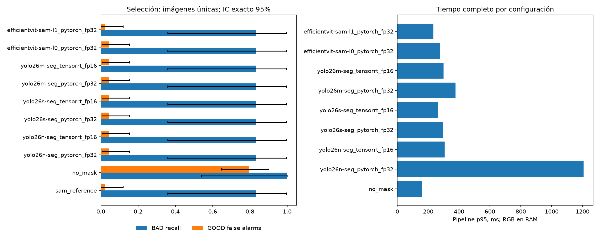
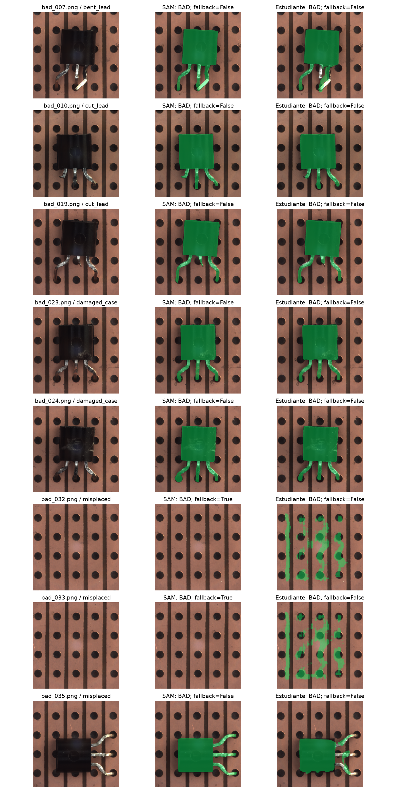

# Estudiante SAM — decisión por clasificación GOOD/BAD

Campaña: 20261110T081240_360939Z
Objetivo: reemplazar la segmentación conservando la detección de BAD y controlando falsas alarmas.

## Conclusión para elegir estudiante
**Candidato seleccionado: efficientvit-sam-l1 con pytorch_fp32.**
Fue la única configuración que conservó recall y FAR de SAM en selección.
En test: SAM y estudiante detectaron 8/8 BAD; nuevos falsos negativos del estudiante: 0.
En el pipeline reconstruido sin fuga, las falsas alarmas fueron SAM 3/55 y estudiante 4/55.
**Conserva el recall observado, pero no queda confirmada equivalencia operativa completa: 1 falsas alarmas adicionales en este test.**
Pipeline completo del estudiante: mediana 211.33 ms, p95 231.30 ms; no confundir con solo segmentación.
La elección es provisional: solo hay 8 BAD en test.
EfficientViT TensorRT FP16 no es válido en este experimento; utilizar el checkpoint FP32.

## Diseño sin fuga
- Segmentadores: train 200, selección 50; test histórico reservado 63.
- Downstream NUEVO: LogReg fit 160; media y entrenamiento EfficientAD solo 139 GOOD-fit.
- Calibración 40 (35 GOOD, 5 BAD): cuantiles EfficientAD, escalas, alpha y cortes; no usa selección/test.
- Selección 50 (44 GOOD, 6 BAD). Test 63 (55 GOOD, 8 BAD), solo SAM y el estudiante fijado.
- Un único DINOv2-base congelado, cabezal, EfficientAD y calibración para todos los candidatos.
- EffAD usa RGB original, nunca máscaras. DINO usa la variante masked con QC/fallback idéntico.
- Artefactos de producción no se modifican; el downstream histórico vio las 50 imágenes de selección y no se usa para escoger.

Alpha de fusión calibrado: 0.15.
Si alpha es 0, la fusión no depende de DINO y no permite atribuir su recall a la segmentación.
El brazo DINO y el control sin máscara se reportan para mostrar ese efecto.

## Resultados en selección
| Configuración | BAD detectados | FN | FP/GOOD | Recall | FAR | Pipeline mediana ms | p95 ms | Nuevos FN vs SAM |
|---|---:|---:|---:|---:|---:|---:|---:|---:|
| sam_reference | 5/6 | 1 | 1/44 | 0.8333 | 0.0227 | — | — | — |
| no_mask | 6/6 | 0 | 35/44 | 1.0000 | 0.7955 | 102.30 | 161.88 | 0 |
| yolo26n-seg_pytorch_fp32 | 5/6 | 1 | 2/44 | 0.8333 | 0.0455 | 226.93 | 1207.74 | 0 |
| yolo26n-seg_tensorrt_fp16 | 5/6 | 1 | 2/44 | 0.8333 | 0.0455 | 189.97 | 306.54 | 0 |
| yolo26s-seg_pytorch_fp32 | 5/6 | 1 | 2/44 | 0.8333 | 0.0455 | 214.45 | 297.90 | 0 |
| yolo26s-seg_tensorrt_fp16 | 5/6 | 1 | 2/44 | 0.8333 | 0.0455 | 182.57 | 264.61 | 0 |
| yolo26m-seg_pytorch_fp32 | 5/6 | 1 | 2/44 | 0.8333 | 0.0455 | 212.38 | 377.14 | 0 |
| yolo26m-seg_tensorrt_fp16 | 5/6 | 1 | 2/44 | 0.8333 | 0.0455 | 187.61 | 300.09 | 0 |
| efficientvit-sam-l0_pytorch_fp32 | 5/6 | 1 | 2/44 | 0.8333 | 0.0455 | 211.02 | 279.05 | 0 |
| efficientvit-sam-l1_pytorch_fp32 | 5/6 | 1 | 1/44 | 0.8333 | 0.0227 | 215.79 | 233.66 | 0 |

## Errores revisables en selección
- sam_reference: FN=bad_022.png; FP=good_209.png.
- no_mask: FN=ninguno; FP=35 archivos; ver false_positives.csv.
- yolo26n-seg_pytorch_fp32: FN=bad_022.png; FP=good_209.png, good_265.png.
- yolo26n-seg_tensorrt_fp16: FN=bad_022.png; FP=good_209.png, good_265.png.
- yolo26s-seg_pytorch_fp32: FN=bad_022.png; FP=good_209.png, good_265.png.
- yolo26s-seg_tensorrt_fp16: FN=bad_022.png; FP=good_209.png, good_265.png.
- yolo26m-seg_pytorch_fp32: FN=bad_022.png; FP=good_209.png, good_265.png.
- yolo26m-seg_tensorrt_fp16: FN=bad_022.png; FP=good_209.png, good_265.png.
- efficientvit-sam-l0_pytorch_fp32: FN=bad_022.png; FP=good_209.png, good_265.png.
- efficientvit-sam-l1_pytorch_fp32: FN=bad_022.png; FP=good_265.png.

## Estudiante elegido
{
  "key": "efficientvit-sam-l1_pytorch_fp32",
  "student": "efficientvit-sam-l1",
  "backend": "pytorch_fp32",
  "eligible": true,
  "recall": 0.8333333333333334,
  "far": 0.022727272727272728,
  "new_fn_vs_sam": 0,
  "pipeline_ms_p95": 233.6599150004076,
  "pipeline_ms_median": 215.7854999986739,
  "validation_run_id": "1fd1fa86a08e422dbbfd6aad196f5baf",
  "status": "provisional_small_sample",
  "checkpoint_sha256": "2f3d28d00edb64864f4d1457ccd9c6e87d323b71aab89d75b79d1d19c26ba6da",
  "engine_sha256": "1c6f4f8fb88420787897e0b62baf3f2c66f9b8507066ce6a152e06d1682ce4dc",
  "calibration_sha256": "70f921e1cd8097815014966523b8ef970e86755911badccd51d58741f42dd7f6",
  "criteria": "no new FN; recall>=SAM; FAR<=SAM; minimum pipeline p95",
  "sealed_utc": "20261111T064737_645089Z"
}
Regla: ningún BAD nuevo perdido respecto de SAM, recall no menor y FAR no mayor; después menor p95 del pipeline.
El control sin máscara es diagnóstico; no se convierte silenciosamente en el estudiante elegido.
La selección es provisional por el tamaño de muestra. No constituye una prueba estadística de no inferioridad.

## Confirmación final en test
| Configuración | BAD detectados | FN | FP/GOOD | Recall | FAR | Pipeline mediana ms | p95 ms |
|---|---:|---:|---:|---:|---:|---:|---:|
| sam_reference | 8/8 | 0 | 3/55 | 1.0000 | 0.0545 | — | — |
| efficientvit-sam-l1_pytorch_fp32 | 8/8 | 0 | 4/55 | 1.0000 | 0.0727 | 211.33 | 231.30 |

Recall exacto IC95% del estudiante: [0.6305833524471807, 1.0].
No se eligió otro estudiante ni se reajustaron umbrales después de ver test.

## Compatibilidad con el pipeline de producción congelado
Mismos 63 ejemplos de test, SAM y SOLO el estudiante ya seleccionado; no se reajusta ningún parámetro.
Se conservan cabezal, fondo y fusión de prod_sam31. La máscara sigue la transformación de inferencia de la sección 8.
EfficientAD no usa máscara: se reutilizan sus scores congelados por imagen. Esta comprobación es de decisiones, no de latencia.
| Configuración | TP | FN | FP | TN | Recall | FAR |
|---|---:|---:|---:|---:|---:|---:|
| sam_reference | 8 | 0 | 10 | 45 | 1.0000 | 0.1818 |
| efficientvit-sam-l1_pytorch_fp32 | 8 | 0 | 7 | 48 | 1.0000 | 0.1273 |
Conserva el punto observado en la reconstrucción sección 8: True
Cache histórico de SAM: TP=8, FN=0, FP=7, TN=48.
El cache histórico y la reconstrucción sección 8 difieren en alarmas: no son baselines intercambiables. El entrenamiento/evaluación batch reduce la máscara a 256 y usa QC; sección 8 redimensiona la máscara completa a 1024 sin ese fallback. Esta auditoría no aisló cuánto contribuye cada diferencia.
Por eso la mejora frente al SAM reconstruido no se presenta como mejora frente al resultado histórico.
Nuevos falsos negativos frente a SAM: 0

## Interpretación y límites
- Recall de BAD y FAR se acompañan de conteos e intervalos exactos 95%; pocos BAD implican incertidumbre amplia.
- McNemar pareado está en el CSV; p grande no demuestra equivalencia.
- La referencia SAM usa máscaras cacheadas para calidad; no se presenta su tiempo cacheado como latencia SAM.
- Estudiantes: latencia completa desde RGB en RAM: segmentación, máscara, DINO, cabezal, EfficientAD y fusión; excluye disco/cámara/carga.
- Tiempos descriptivos de esta sesión con logs y vistas activas; hubo variabilidad, por lo que no son un SLA ni una medición de hardware reservado.
- DINO y EfficientAD de inferencia corren en GPU; el cabezal ONNX corre en CPU. Esta es la receta reconstruida sin fuga, no el tiempo del deployment histórico.
- Las variantes EfficientViT TensorRT FP16 con NaN fueron excluidas antes de esta comparación.
- El test es el histórico del repo y ya fue usado en experimentos anteriores; no es una nueva captura externa.
- Esta elección se basa en preservar recall/FAR y reducir latencia; no implica cumplir el objetivo previo de segmentación p95 <=20 ms.
- false_negatives.csv, false_positives.csv y paired_vs_sam.csv guardan las imágenes y scores de cada decisión.
- El reporte anterior de IoU permanece como evaluación de segmentación; este reporte utiliza etiquetas GOOD/BAD reales.

## Artefactos
Experimento MLflow: transistor-binary-sam-distillation
Datos y logs: C:\Users\marti\Documents\BetterClasificator\models\transistor_binary\sam_distillation\c1743b64b515a6ee\20261110T081240_360939Z\classification
Resultados completos: classification_results.csv; defectos: recall_by_defect.csv.

## Todos los BAD de test

<!-- inference-latency:start -->
## Tiempos de inferencia del estudiante elegido

**EfficientViT-SAM-L1, PyTorch FP32, batch 1, GPU NVIDIA GeForce RTX 4070 Laptop GPU.**

| Alcance de la medición | Mediana (ms/imagen) | p95 (ms/imagen) |
|---|---:|---:|
| Segmentación: imagen RGB en RAM → máscara | 62.16 | 75.08 |
| Pipeline completo: segmentación + preprocesamiento de máscara + DINOv2 + clasificador + EfficientAD + fusión GOOD/BAD | 211.33 | 231.30 |

1000 / mediana del pipeline = **4.73 imágenes/s estimadas** en procesamiento secuencial. Es una conversión de latencia, no throughput sostenido medido ni FPS de cámara.

El p95 es el percentil 95 de las latencias observadas: aproximadamente el 95% de las mediciones quedó por debajo de ese tiempo.

Protocolo de segmentación: 20 calentamientos, 200 mediciones sobre 50 imágenes únicas de validación, resolución de entrada 512 × 512; sincronización CUDA; sin Nsight ni NVTX en la medición de tiempo.
Protocolo del pipeline: 20 calentamientos, 200 mediciones sobre 63 imágenes únicas de test; entradas RGB en RAM y modelos cargados.

Ambos tiempos excluyen captura de cámara, lectura del disco y carga de modelos. La segmentación incluye el preprocesamiento y posprocesamiento del adaptador; no es solamente el forward de la red.
Las dos filas proceden de evaluaciones distintas (validación de segmentación y test del pipeline). No deben restarse para atribuir un coste exacto al clasificador.
Resultados descriptivos de esta sesión, con logs y vistas activas; no constituyen un SLA. El objetivo inicial de segmentar en 5–20 ms no se alcanzó con este candidato FP32.

La recomendación corresponde al checkpoint PyTorch FP32. El backend EfficientViT TensorRT FP16 produjo valores no finitos y fue excluido.

**Trazabilidad:**
- Segmentación: C:\Users\marti\Documents\BetterClasificator\models\transistor_binary\sam_distillation\c1743b64b515a6ee\20261110T081240_360939Z\evaluations\efficientvit-sam-l1_pytorch_fp32_val_20261111T043234_791152Z\timings.csv; MLflow run 8e630cc615ce414896a9537cb1233299.
- Pipeline: C:\Users\marti\Documents\BetterClasificator\models\transistor_binary\sam_distillation\c1743b64b515a6ee\20261110T081240_360939Z\classification\evaluations\test\efficientvit-sam-l1_pytorch_fp32\timings.csv; MLflow run 52caff9c2a344288a40fb36bfc3148fc.

<!-- inference-latency:end -->
